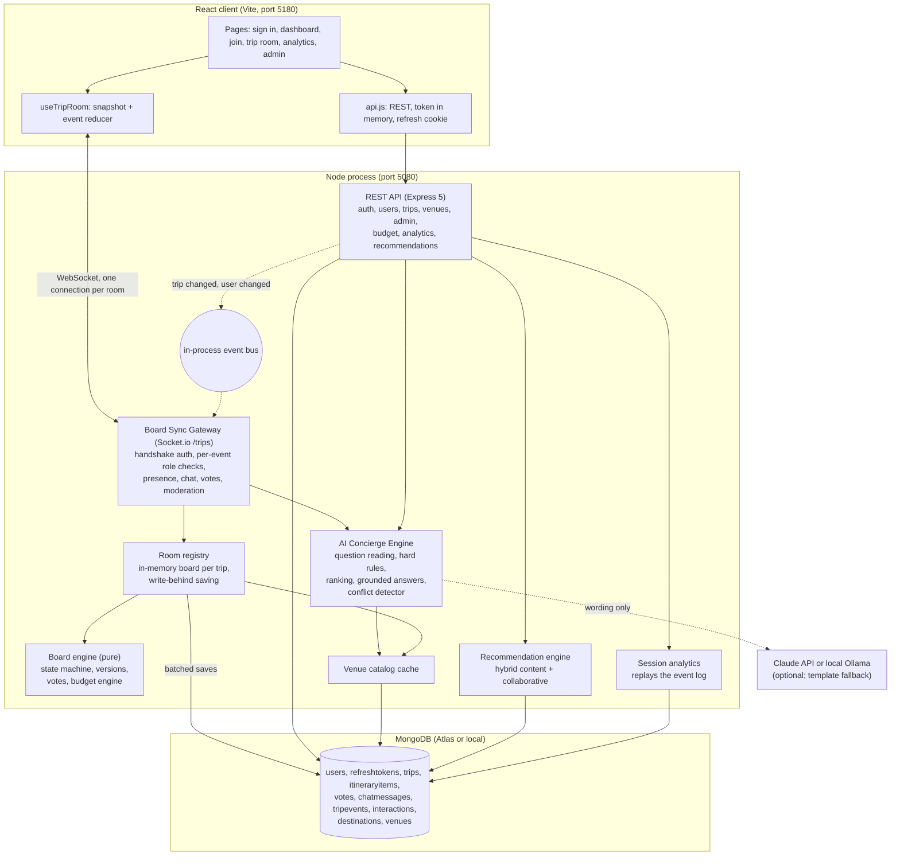

# Architecture (as built)

This extends spec section 7 with what was actually built. Every layer in
the spec's diagram exists as its own module; they run in one Node process on
one port, but none of them imports another's internals, so they could be
split later (spec 9.4).

## Layers

| Layer (spec 7.1) | Code | What it does |
|---|---|---|
| Client | `client/src` | React 19 + React Router. `useTripRoom` holds the live room state and applies every server event; the server is the only source of truth. |
| Application API | `server/src/app.js`, `auth/`, `users/`, `trips/`, `venues/`, `admin/` | Express 5 REST API. zod validation on every input, a JSON error shape, helmet, CORS, rate limits. |
| Board Sync Gateway | `server/src/realtime/` | Socket.io namespace `/trips`. Authenticates at the handshake, checks the role on every event, and re-reads the role and token expiry for sensitive actions. |
| Rooms and board engine | `server/src/board/` | `boardState.js` (pure state machine with version checks), `votes.js`, `budgetEngine.js`, and `room.js` (in-memory board, presence, write-behind saves, event log). |
| AI Concierge Engine | `server/src/concierge/` | `interpret.js` → `constraints.js` (hard rules, ranking) → `answer.js` (Claude / Ollama / template, with a grounding check). `conflicts.js` is the conflict detector. |
| Recommendations | `server/src/recs/` | Interactions model, hybrid recommender, synthetic data generator, Precision@5 evaluation. |
| Analytics | `server/src/analytics/` | Session analytics computed only from `tripevents`, plus the replay check. |
| Persistence | Mongoose 9 | One shared connection pool for REST and the gateway (spec 9.2). |

## Request paths

**A move on the board** (the hot path, spec 6.1):
1. The client emits `trip.board.move` with the version it last saw.
2. The gateway checks the role from the room's cached copy of the trip; no database read.
3. `moveItem()` compares versions and applies the move synchronously, so two
   moves can never interleave.
4. The server broadcasts `trip.board.update` to the room (the sender included),
   and a loser gets `trip.board.rejected`.
5. The conflict detector re-runs and announces new or resolved conflicts.
6. The move is saved within 250 ms in a batch, and an event-log row is written.

The broadcast in step 4 doesn't wait for the database, which is why sync drift
stays in single-digit milliseconds even against a remote database
(see [PERFORMANCE.md](PERFORMANCE.md)).

**A Concierge question** (spec 6.2, 7.3.3):
1. The question becomes constraints, using rules rather than the LLM.
2. Every venue in the destination is checked against the four hard rules.
3. The venues that pass are ranked 40% distance, 30% rating, 30% budget headroom.
4. The top candidates go to the LLM (if configured), with venue ids restricted
   to those candidates.
5. The reply is fact-checked (prices, times, venue names, walking minutes) and
   quality-checked; if it fails, or times out, the template answer is used.
6. The answer is returned with the cited records and the constraints applied,
   broadcast to the room and saved in the chat.

**Changes made over REST that affect a live room** (joins, role changes,
settings, preferences, dataset uploads) are announced on the in-process event
bus, and the gateway refreshes the open room.

## Scaling beyond one process

Rooms, the event bus and the catalog cache live in one process. That is fine
for this project and was load-tested with 50 travellers in one room (see
[PERFORMANCE.md](PERFORMANCE.md)). Running several processes would need:
- the Socket.io Redis adapter, with sticky sessions;
- a shared pub/sub (for example Redis) in place of the event bus;
- room ownership per trip (one process owns a trip's board), or moving the
  version check into the database (`findOneAndUpdate` with the expected version).

Nothing in the code assumes a single room: rooms are independent, and a test
checks that they never see each other's events.

## Other documents

- [DATA-MODEL.md](DATA-MODEL.md): collections and the ER diagram
- [API.md](API.md): REST endpoints and WebSocket events
- [DECISIONS.md](DECISIONS.md): decisions and deviations from the spec, by phase
- [PERFORMANCE.md](PERFORMANCE.md): measured numbers against spec 10.2
- [SECURITY.md](SECURITY.md): the security review
- [TEST-REPORT.md](TEST-REPORT.md): what is tested and the results
- [DEMO.md](DEMO.md): a step-by-step demo for the walkthrough recording
- [RETROSPECTIVE.md](RETROSPECTIVE.md): what was built, what was cut, what's next
