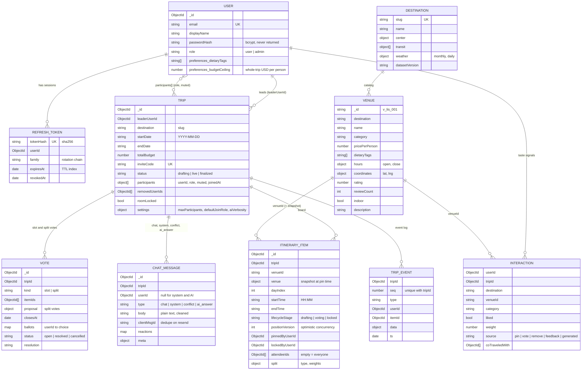

# Data model (as shipped)

MongoDB through Mongoose (spec Option B). The six core entities from spec 7.2
are all present (User, Trip, ItineraryItem, VenueMetadata, ChatMessage,
Interaction), plus five supporting collections. Model files are listed under
each table.

## Collections

| Collection | Model file | Key indexes | Notes |
|---|---|---|---|
| `users` | `auth/user.model.js` | `email` unique | `role` is the account role; trip roles live on each trip |
| `refreshtokens` | `auth/refreshToken.model.js` | `tokenHash` unique, `userId`, `family`, `expiresAt` TTL | Only hashes are stored; rotation with reuse detection |
| `trips` | `trips/trip.model.js` | `inviteCode` unique, `(participants.userId, createdAt)` | `participants[]` carries the per-trip role (Viewer, Planner, Leader) |
| `itineraryitems` | `board/itineraryItem.model.js` | `(tripId, dayIndex)` (spec 9.2) | `positionVersion` is the optimistic-concurrency field (spec 7.2) |
| `votes` | `board/vote.model.js` | `tripId` | Slot and budget-split votes; open votes are restored when a room reloads |
| `chatmessages` | `chat/chatMessage.model.js` | `(tripId, createdAt)`, `(tripId, userId, clientMsgId)` unique (partial) | Doubles as the notice log (`system`, `conflict`, `ai_answer`), as spec 7.2.1 allows |
| `tripevents` | `board/tripEvent.model.js` | `(tripId, seq)` unique | Event log behind session analytics |
| `destinations` | `venues/destination.model.js` | `slug` unique | Transit links and mocked weather |
| `venues` | `venues/venue.model.js` | `(destination, coordinates.lat, coordinates.lng)` (spec 9.2), `(destination, category)` | `_id` is the dataset's venue id |
| `interactions` | `recs/interaction.model.js` | `userId`, `(destination, venueId)` | Feeds the recommender |

## Differences from the spec's reference schema (7.2.1)

- **Roles:** `users.role` is `user` or `admin`; Viewer, Planner and Leader are
  per-trip roles in `trips.participants[]` (see DECISIONS.md, Phase 1).
- **`itinerary_items.votes`:** this field exists, but votes live in their own
  `votes` collection, because a vote spans several items and has its own
  lifecycle.
- **Item cost data** is a `venue` snapshot taken at pin time, so a later dataset
  upload doesn't change an existing board's budget.
- **Added for later phases:** `attendeeIds` and `split` on items,
  `removedUserIds` and `roomLocked` on trips, and the `tripevents` and
  `refreshtokens` collections.
